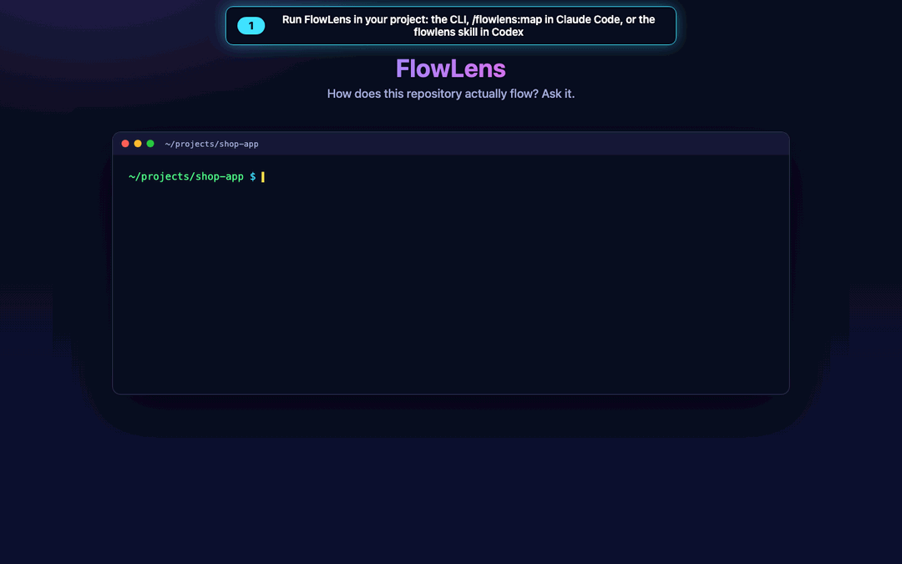

# FlowLens

FlowLens reads a repository and generates an interactive HTML map of how the code fits together: which frontend calls reach which API routes, what each handler calls and which stores it reads or writes, how modules depend on each other, and how agents hand work to each other. Every relationship points to the file and line it came from. The map is a single offline HTML file, so it opens in any browser with no server and no agent running.

FlowLens runs from a command-line tool (CLI). A Claude Code plugin and a Codex plugin wrap that same CLI.

> "FlowLens" is a provisional name. The project is MIT licensed.



*How it works, in about a minute:*

1. Run `flowlens scan` in your project, or `/flowlens:map` in Claude Code, or the `flowlens` skill in Codex.
2. Open the generated map. It is a single offline HTML file.
3. Pick a scenario and press Play to replay it step by step.
4. Click any step to see how it was established, and its file:line evidence.
5. Filter by relationship or provenance to switch views without re-scanning.
6. Agent graphs work the same way, with branches and runtime-only targets marked.

Demo reports, generated from the two synthetic fixtures (open them in a browser):

- [examples/shop-app/flowmap.html](examples/shop-app/flowmap.html): a web client calls a FastAPI backend, which writes to SQLite and Redis and calls a webhook.
- [examples/agent-desk/flowmap.html](examples/agent-desk/flowmap.html): a LangGraph-style state graph with conditional routing, plus an Agents-SDK-style triage agent with handoffs and a tool.

## Contents

- [Install and first run](#install-and-first-run)
- [Using the CLI](#using-the-cli)
- [Scope, presets and saved settings](#scope-presets-and-saved-settings)
- [Reading the map](#reading-the-map)
- [Observed, inferred and unresolved](#observed-inferred-and-unresolved)
- [Replays are not traces](#replays-are-not-traces)
- [Supported languages and frameworks](#supported-languages-and-frameworks)
- [Safety and privacy](#safety-and-privacy)
- [Limitations](#limitations)
- [Development](#development)

## Install and first run

Requirements: Node.js 20 or later. Python 3.8 or later is needed to analyze Python files. Without it, FlowLens still maps JavaScript and TypeScript and reports the Python files as not analyzed.

All three options use the engine in `plugins/*/flowlens/engine/`, which is built from `src/` and checked in. Clone the repository first:

```sh
git clone <this repository> flowlens
```

### Claude Code

Add the repository as a plugin marketplace, install the plugin, then ask for a map from inside the project you want to analyze:

```text
/plugin marketplace add /path/to/flowlens
/plugin install flowlens@flowlens
/flowlens:map
```

`/flowlens:map` shows the resolved root, asks for the scope and relationships the first time, scans, and gives you the path to the report. `/flowlens:setup` changes the saved scope. While the plugin is enabled, the `flowlens` command is also on the PATH of Claude's Bash tool.

To try the plugin without installing it:

```sh
cd /path/to/your/project
claude --plugin-dir /path/to/flowlens/plugins/claude/flowlens
```

When the repository is on GitHub, `/plugin marketplace add <owner>/<repo>` also works. That route has not been tested yet; see [Limitations](#limitations).

### Codex

```sh
codex plugin marketplace add /path/to/flowlens
codex plugin add flowlens@flowlens
```

Then, in a Codex session inside your project, ask Codex to "map this repository with FlowLens", or invoke the `flowlens` skill directly. The skill calls the plugin's `scripts/flowlens` wrapper.

### Command line (any agent or none)

```sh
cd /path/to/flowlens
npm install
npm run build          # writes dist/flowlens.mjs and refreshes both plugin engines
npm link               # optional: puts `flowlens` on your PATH

cd /path/to/your/project
flowlens scan --open   # or: node /path/to/flowlens/dist/flowlens.mjs scan --open
```

Any agent that can run shell commands can use the CLI the same way.

## Using the CLI

```text
flowlens scan                       analyze and write the map (uses saved settings if any)
flowlens scan --preset backend,frontend --relations api,data --save
flowlens scan --include services/api,web/src --exclude "**/*.test.ts" --open
flowlens scan --root ../other-repo --out /tmp/map --json
flowlens regenerate --open          repeat the saved scope and relationships
flowlens setup                      guided setup in the terminal (interactive)
flowlens presets [--json]           show the folders each preset resolves to, with reasons
flowlens root [--json]              show the resolved repository root
flowlens config                     show the saved settings
flowlens open                       open the last map in the default browser
flowlens render graph.json --out map.html   render a report from an existing graph
flowlens validate graph.json        check a graph file against the schema
```

Every run prints the root it resolved and the scope before scanning. By default the root is the nearest folder above the current directory that contains `.git`, so running from `apps/web/src` in a monorepo scans the whole monorepo unless you narrow it. Use `--root` to override, or `--preset here` to scan only the current folder.

Output goes to `<root>/.flowlens/` by default:

| File | Content |
| --- | --- |
| `flowmap.html` | the self-contained report |
| `graph.json` | the typed graph (schema `flowlens.graph` 1.0.0), for tooling and debugging |
| `config.json` | saved settings, written only with `--save` or `setup` |
| `.gitignore` | keeps the generated files out of git, but lets you commit `config.json` |

## Scope, presets and saved settings

The scope is the set of folders to scan. The relationships are the kinds of edges to extract.

| Preset | Resolves to |
| --- | --- |
| `whole` | the whole repository |
| `backend` | folders whose manifest lists FastAPI, Flask, Django, Express, Fastify, NestJS and similar, or folders named `backend`, `server`, `api`, `services` |
| `frontend` | folders whose manifest lists React, Vue, Svelte, Angular, Next and similar, folders named `web`, `frontend`, `client`, `ui`, or folders made mostly of `.tsx`/`.jsx` |
| `agents` | folders whose manifest lists LangGraph, OpenAI Agents, CrewAI and similar, or whose files import them |
| `here` | the folder you ran the command from |

Combine presets (`--preset backend,frontend`), add folders (`--include`), and add gitignore-style exclusions (`--exclude`). `flowlens presets` prints what each preset resolves to before you scan. A folder name alone never pulls in a folder that sits inside a package of another kind, so `web/src/api/` in a React app is not treated as backend.

The four relationship types are:

| Relationship | Edges |
| --- | --- |
| `api` | function → HTTP request, request → route, route → handler, request → external host |
| `data` | function → SQL table, ORM model, key-value store, browser storage or task queue (reads, writes, enqueues) |
| `deps` | module → module imports |
| `agents` | agent → agent handoffs, agent → tool, agent or tool → implementing function |

Function calls are always analyzed, because they connect the others.

`--save` (or `setup`) stores the scope and relationships in `.flowlens/config.json`. Later runs use the file automatically, and options you pass on the command line override it for that run. `--no-saved` ignores it. You can also edit the file by hand:

```json
{
  "version": 1,
  "presets": ["backend", "frontend"],
  "include": ["api", "web"],
  "exclude": ["**/*.test.ts"],
  "relations": ["api", "data", "deps", "agents"],
  "outDir": ".flowlens",
  "features": { "checkout": ["web/src/pages/CheckoutPage.tsx", "api/app/routes/orders.py"] }
}
```

`features` is optional. It groups paths into named features for the report's filters. Without it, a node's feature is the first two folders of its path. Setting `"editorLinks": true`, or passing `--editor-links`, adds `vscode://` links to the evidence. This writes absolute paths into the report, so it is off by default.

## Reading the map

The report has the same layout on every repository:

- **Lanes**, left to right: Frontend, Requests, API routes, Application code, Agents & tools, Stores & queues, and External & unresolved. Empty lanes are hidden.
- **Scenarios** (left panel): entry journeys (everything reachable from a function nothing else calls, such as a UI handler), API calls (one client request), server routes with no client in the scan, and agent handoff graphs.
- **Replay controls**: Restart, Back, Play/Pause, Next and speed (0.5× to 4×). Follow keeps the current step in view at a readable zoom, and Fit shows the whole map. The active node and edge are highlighted, and the event stream stays in step with them.
- **Now** panel: the current step, whether it was observed, inferred or unresolved, the reason for an inference, what data is passed when the source names it, and links to the evidence locations.
- **Details** panel: click a node or an edge (or Tab to a node and press Enter) to see its source location, its incoming and outgoing edges with evidence, branch alternatives, and the scenarios it appears in.
- **Filters**: relationship types, how each edge was established, and features. Filters switch between results that were already analyzed and never re-run the analysis. A relationship type that was not analyzed is greyed out and marked "not scanned". Top-level folders outside the scanned scope are listed as "not scanned".
- **Re-scan** panel: choose folders and relationships to build the exact `flowlens scan …` command for a new scan.
- **Coverage and Diagnostics**: files analyzed, skipped files by reason, adapter status, languages without an analyzer, unsupported frameworks, and parse problems.
- **Modules / Functions** switch: the overview combines functions into their modules and shows the number of combined edges. The Functions view shows each function.

Keyboard: `/` search, `←`/`→` step, `Space` play or pause, `Home` restart, `+`/`-` zoom, `0` fit, `Esc` clear the selection. With reduced motion enabled in the OS, animations are switched off. The URL hash keeps the view (for example `#scenario=…&step=4`), so a link can point to a specific step.

## Observed, inferred and unresolved

Every edge carries one of three provenances, and the map shows each one differently:

| Provenance | Meaning | Drawn as |
| --- | --- | --- |
| **observed** | The relationship is written directly in source at the evidence location, for example a call, a route decorator, a literal SQL table or a literal handoff list. | solid line |
| **inferred** | Two observed facts are joined by a stated rule. Examples: a `fetch('/api/orders')` is matched to `POST /api/orders` because method and path match (the base URL is decided at runtime), or a router function returns `"escalate"`, which is a registered node name. The `reason` field says which rule applied. | dashed line |
| **unresolved** | Source shows that a relationship exists, but its target is computed at runtime: a URL from a variable, `Command(goto=next_step)`, a handoff list built by a function, or a request with no matching route in the scan. | dotted line to an "unresolved" node |

FlowLens never creates an edge from naming similarity alone. When it cannot read a target, it records the edge as unresolved. Conditional branches are kept as alternatives at the same decision point, and replays mark them "alternative 1 of 2" with the condition.

## Replays are not traces

A scenario replay is reconstructed from source code: it walks the observed, inferred and unresolved edges from an entry point in source order. It does not record timing, traffic, database activity or results. The report labels every replay "simulated" and shows no durations. Conditional branches are listed one after another, but at runtime only one of them runs.

A **runtime trace** would be a recording of a real execution. FlowLens does not collect traces in this release. The graph schema has an empty `traces` field reserved for a future adapter, which would keep traces separate from static evidence in both the data and the presentation.

## Supported languages and frameworks

| Area | Supported patterns | Status |
| --- | --- | --- |
| Python | imports (absolute and relative, packages), functions, methods, calls through imports and `self` | supported (stdlib `ast`) |
| JavaScript / TypeScript | ES imports, `require`, dynamic `import()`, functions, arrow functions, classes, React components, JSX | supported (`@babel/parser`) |
| FastAPI | `FastAPI()`, `APIRouter(prefix=…)`, `@app.get/post/…`, `api_route`, `include_router(prefix=…)`, typed body parameters | supported |
| Flask | `@app.route`, `Blueprint(url_prefix=…)`, `register_blueprint` | partial |
| Express | `express()`, `Router()`, `app.get/post/…`, `app.use(prefix, router)` | partial |
| HTTP clients | `fetch`, `axios` and `axios.create()` instances, `requests`, `httpx` (module and client) | supported |
| Data | literal SQL in `execute()` (sqlite3, DB-API, SQLAlchemy `text`), SQLAlchemy session `add`/`query`, Redis, `localStorage`/`sessionStorage`, Celery `delay`/`apply_async` | supported |
| LangGraph | `StateGraph`, `add_node`, `add_edge`, `add_conditional_edges` (literal maps, or router functions returning literals), `set_entry_point`, `START`/`END`, `compile().invoke`, `Command(goto=…)` | supported |
| Agents SDKs | `Agent(name=…, handoffs=[…], tools=[…])` in Python and JS, `@function_tool`, `Runner.run(agent)` | supported |
| Django, Fastify, Koa, Hono, NestJS, Next.js routes, tRPC, GraphQL, CrewAI, AutoGen | detected from manifests | **no adapter**: reported in Diagnostics |
| Go, Rust, Java and other languages | counted | **no adapter**: reported in Coverage |

Framework and language adapters are separate modules that produce the same per-file facts (`src/analyze/facts.ts`), so adding one does not touch the graph builder or the renderer.

## Safety and privacy

- **Read-only and local.** FlowLens reads files and writes only to its output folder. It needs no network, cloud service or credentials.
- **Never runs your code.** Python files are parsed with the standard `ast` module in an isolated interpreter (`python3 -I`), and JS/TS files with Babel's parser. Nothing from the analyzed project is imported, executed or installed.
- **Skips by default:** dependency and build folders (`node_modules`, `.venv`, `dist`, `build`, `__pycache__`, …), everything matched by `.gitignore` files (root and nested) and `.flowlensignore`, binary and minified files, files over 1 MB, and secret-like files (`.env*`, keys and certificates, `credentials*`, `secrets*`, `service-account*.json`, `.npmrc`, `*.tfvars`, …). Skipped files are counted by reason in the Coverage panel. Their names are not listed.
- **Symlinks:** a symlinked file is read only when its target is inside the root. Symlinked folders are never followed.
- **No raw source in the report.** Evidence is a path, a line number and a short description written by the analyzer. Literal values appear only when they are route paths, URL paths, SQL table names or graph node names. Data descriptions are identifier names.
- **Untrusted labels are escaped.** The graph is embedded as JSON with `<`, `>` and `&` escaped, and the page inserts all repository text with `textContent`. A Content-Security-Policy blocks all network access and external resources.
- **Relative paths.** Paths in the graph are repository-relative. Source links in the report are relative to the report file unless you opt into `--editor-links`.

## Limitations

- Call resolution is static and name-based within import scopes: calls through variables, dependency injection, decorators that wrap functions, or dynamic dispatch are not followed. Method calls are resolved only on `self`/`this` and on classes in the same file.
- Request-to-route matching compares the HTTP method and path. Proxies, rewrites and base URLs are runtime concerns, so these links are always "inferred".
- TypeScript path aliases are only understood for `@/` and `~/` (resolved under the nearest `src/`). `tsconfig.json` `paths` are not read yet.
- Large repositories: the map draws at most 700 nodes at a time (the most connected ones) and says so. Narrow it with the feature filter or a smaller scope.
- Tested on macOS with Node 26, Python 3.15 and Chrome. Windows and Linux `open` behavior (`start` / `xdg-open`) is implemented but not tested.
- The Claude Code plugin was loaded with `--plugin-dir` and its `/flowlens:map` skill ran end to end in a headless session. The Codex plugin was installed with `codex plugin marketplace add` and `codex plugin add` into an isolated Codex home, and its wrapper ran from the install cache. A Codex model session invoking the skill, and installing either plugin from GitHub, have not been run.

## Development

```sh
npm install
npm run check      # typecheck, build, all tests, CLI tests against the bundle, package checks
npm run dev -- scan --root fixtures/shop-app --out /tmp/shop   # run from source (Node 22.18+ runs TypeScript directly)
npm run demo       # regenerate examples/ from the fixtures
```

- [docs/ARCHITECTURE.md](docs/ARCHITECTURE.md) describes the pipeline, the graph schema and how to add an adapter.
- [CONTRIBUTING.md](CONTRIBUTING.md) describes the workflow and the checks.
- `fixtures/shop-app` and `fixtures/agent-desk` are two synthetic repositories with different structures. The tests run the same engine and renderer on both.
